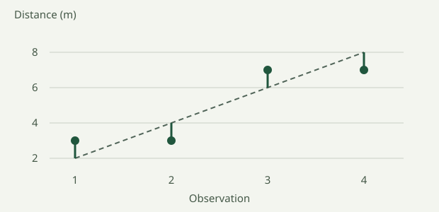

A model draws one line. The measurements land on either side. Before reaching for a summary statistic, it is worth drawing the distance between each measurement and its prediction. That short line segment has a direction as well as a length.

## Four predictions on paper

Imagine measuring the distance of a cart from a wall. At four successive observations the model predicts 2, 4, 6, and 8 metres. The instrument reports 3, 3, 7, and 7 metres. These numbers are deliberately small enough to check by hand.

<figure>



<figcaption>Predicted distance follows the dashed line. The solid circles show measured distance, and the short vertical lines show the four residuals.</figcaption>
</figure>

| Observation | Prediction (m) | Measurement (m) | Residual (m) |
| --- | ---: | ---: | ---: |
| 1 | 2 | 3 | +1 |
| 2 | 4 | 3 | −1 |
| 3 | 6 | 7 | +1 |
| 4 | 8 | 7 | −1 |

## Choose a sign convention

Here a residual is the measurement minus the prediction: $r_i = y_i - \hat{y}_i$. Positive means the measured cart was farther from the wall than the model expected. Averaging our four residuals gives zero, although the model never predicts a single observation exactly.

Taking the absolute value before averaging answers a different question. How far away is a typical prediction, ignoring direction?

$$
\operatorname{MAE} = \frac{1}{n}\sum_{i=1}^{n}|r_i| = 1\,\mathrm{m}.
$$

- Keep the sign when studying whether predictions are systematically high or low.
- Keep the units when reporting the magnitude of the model’s error.
- Keep the individual observations when the sample is this small.[^sample]

[^sample]: Four points make a convenient worked example. Repeated measurements over a broader range would be needed to describe a deployed model.

## Reproduce the calculation

```python
from statistics import mean

observed = [3, 3, 7, 7]
predicted = [2, 4, 6, 8]
errors = [y - y_hat for y, y_hat in zip(observed, predicted, strict=True)]

print(mean(errors))                # 0 m
print(mean(abs(e) for e in errors))  # 1 m
```

In a bilingual notebook the variable name may stay in English while the description changes. For example:

<blockquote lang="fa" dir="rtl">
<p>در این مثال، <bdi dir="ltr" lang="en">residual</bdi> یعنی «باقی‌مانده»: مقدار مشاهده‌شده منهای مقدار پیش‌بینی‌شده. در ردیف اولِ جدول، حاصل تفریق <bdi dir="ltr">3 − 2 = +1</bdi> متر است.</p>
</blockquote>

Writing down that convention next to the figure takes one sentence. It also makes the plot readable to someone who has never seen the notebook.
